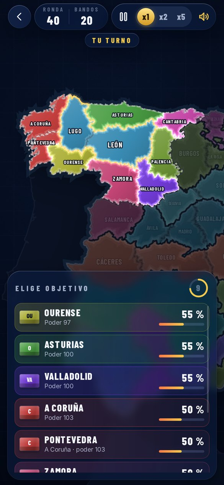

# España en Guerra

Estrategia por turnos con las 47 provincias de la España peninsular. Una ruleta elige quién ataca, se tiran tres dados por bando y la provincia cambia de color hasta que solo queda uno. Web app con aspecto de iOS que se instala en el iPhone y funciona sin conexión.

<p align="center">
  
  
  
  
  
  
</p>

## Instalar en el iPhone

1. Abre **https://zyro0-z.github.io/Spain-War/** en Safari.
2. Pulsa **Compartir › Añadir a pantalla de inicio**.

## Cómo se juega

**Conquista** (un jugador): eliges escenario (las 47 provincias, las comunidades autónomas o los reinos hacia 1200), tu bando y la dificultad. En tu turno tocas una provincia para atacar, mover tropas, reclutar, construir, espiar o hablar con otro bando; al terminar el turno actúan los bots.

- Combate con dados: cada lado tira 3d6 y gana quien saque más con «suma × fuerza». La fuerza sale de las tropas, el terreno, los edificios, la moral y los generales, y la probabilidad exacta se ve antes de atacar.
- Oro por provincia según su población; con él reclutas, construyes y haces diplomacia.
- Diplomacia: paz, pacto de no agresión, alianza, regalos, tributo y anexión pacífica. Antes de proponer ves si aceptarán y por qué. Romper un pacto es traición: todos desconfían.
- Dificultad: **Fácil**, todos en paz y solo pelea contigo quien atacas · **Normal**, los bots se hacen la guerra y te atacan si te ven débil o si creces mucho · **Difícil**, guerra total y coalición contra el líder.
- Profundidad: terreno (montañas y sierras defienden mejor), suministro desde tu capital, lealtad y rebeliones en lo conquistado, edificios (fortaleza, cuartel, puerto, mercado), árbol de mejoras (logística, artillería, diplomacia, espionaje), generales con habilidades que suben de nivel, espionaje, eventos y estaciones con nieve en invierno.
- Reglas opcionales: niebla de guerra, eventos, estaciones y tipo de victoria (dominación, capitales, diplomática o puntos).
- Las partidas se guardan solas (hasta 5) y puedes deshacer movimientos, reclutas y edificios hasta tu último ataque.

Reglas completas y números en [docs/DISENO.md](docs/DISENO.md).

**Espectador**: las 47 provincias luchan solas con ruleta y dados (el modo original). La semilla repite la partida exacta (`?semilla=CÓDIGO`).

**Multijugador** (2 a 8 móviles, necesita internet): sala con código, enlace y QR. De momento usa el sistema de ruleta; se pasará al de conquista.

## Accesibilidad y ajustes

Temas Marina y Atlas, contraste alto, menos animaciones (cortes directos, sin partículas ni temblores), tamaño de texto según el iPhone o a mano, anuncios de cada ronda para VoiceOver, sonido sintetizado con interruptor y medidor de fotogramas.

## Desarrollo

Sin dependencias en tiempo de ejecución ni compilación: HTML, CSS y módulos de JavaScript con JSDoc y `// @ts-check`.

```
npm start            # servidor local en http://localhost:8080
npm test             # pruebas con node --test
npm run build:map    # regenera data/map.json (necesita npm install)
npm run flags        # descarga las banderas de Wikimedia Commons (o Actions › Banderas › Run workflow)
node scripts/shots.mjs webkit shots   # capturas en tamaño iPhone 14 con WebKit (WebKitWebDriver + Xvfb)
node scripts/shots.mjs chromium shots # lo mismo con Playwright y Chromium
node scripts/icons.mjs                # iconos de la app
```

| Ruta | Contenido |
| --- | --- |
| `js/engine/` | Reglas puras y deterministas: generador con semilla, probabilidad exacta, partida y bots |
| `js/net/` | Sala multijugador: transporte ntfy (y local para pruebas) y protocolo anfitrión/invitado |
| `js/qr.js` | Código QR propio, sin librerías |
| `js/flags.js` | Banderas de las provincias |
| `js/map/render.js` | Mapa en canvas: imagen en memoria, cámara, atenuado, onda de conquista y nombres |
| `js/ui/` | Menú, partida, conductores (normal, un jugador, anfitrión, invitado), sala, ruleta, dados 3D, ajustes y reloj con pausa |
| `js/art.js` | Paleta de bandos e ilustraciones |
| `js/icons.js` | Iconos propios en dos tonos |
| `js/fx.js` | Sonido (WebAudio), partículas y temblor |
| `js/store.js` | Estado guardado y migraciones |
| `data/map.json` | Provincias, adyacencia, fronteras compartidas, costa y tierra vecina |
| `scripts/` | Generación del mapa, capturas e iconos |
| `sw.js` | Modo sin conexión |

Al publicar cambios, sube la versión de `CACHE` en `sw.js` para que los móviles descarguen la nueva.

Créditos y licencias en [CREDITS.md](CREDITS.md).

## Probar el multijugador sin internet

Abre dos pestañas del mismo navegador con `?red=local` (la sala va por BroadcastChannel en vez de ntfy.sh). Las pruebas del protocolo (`tests/room.test.mjs`) usan un ntfy simulado: orden de mensajes, reconexión, anfitrión caído, tiempo agotado y reintentos ante 429.
