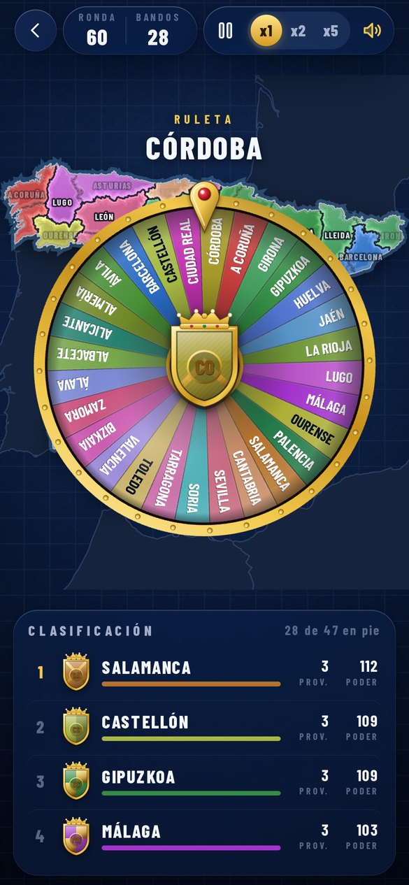
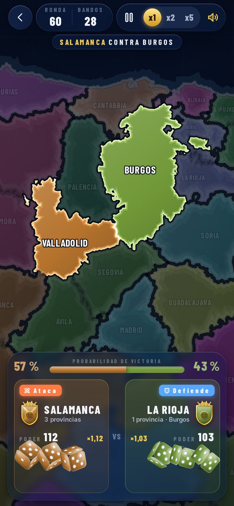
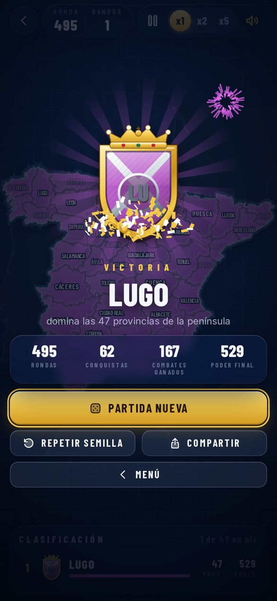

# España en Guerra

Estrategia por turnos con las 47 provincias de la España peninsular. Una ruleta elige quién ataca, se tiran tres dados por bando y la provincia cambia de color hasta que solo queda uno. Web app con aspecto de iOS que se instala en el iPhone y funciona sin conexión.

<p align="center">
  
  
  
  
</p>

## Instalar en el iPhone

1. Abre **https://zyro0-z.github.io/Spain-War/** en Safari.
2. Pulsa **Compartir › Añadir a pantalla de inicio**.

## Reglas

- Al empezar, cada provincia es un bando con poder 100. El poder y la eliminación son del bando.
- Cada ronda, la ruleta elige un bando vivo, que ataca una provincia enemiga limítrofe con alguna suya. El defensor es su dueño.
- Cada bando tira 3d6. Puntuación = suma × poder/100. Si empatan, se repite la tirada.
- El ganador suma 3 de poder y el perdedor resta 3 (mínimo 1). Si gana el atacante, conquista la provincia.
- Un bando sin provincias queda eliminado. La partida termina cuando queda uno.
- Antes de cada combate se muestra la probabilidad exacta de victoria (convolución de 3d6 con ambos poderes).

## Modos

- **Normal**: simulación automática con pausa y velocidad x1, x2 y x5. La semilla reproduce la partida exacta en cualquier móvil (`?semilla=CÓDIGO`).
- **Un jugador** y **Multijugador**: en desarrollo.

## Accesibilidad y ajustes

Temas Marina y Atlas, contraste alto, menos animaciones (cortes directos, sin partículas ni temblores), tamaño de texto según el iPhone o a mano, anuncios de cada ronda para VoiceOver, sonido sintetizado con interruptor y medidor de fotogramas.

## Desarrollo

Sin dependencias en tiempo de ejecución ni compilación: HTML, CSS y módulos de JavaScript con JSDoc y `// @ts-check`.

```
npm start            # servidor local en http://localhost:8080
npm test             # pruebas con node --test
npm run build:map    # regenera data/map.json (necesita npm install)
node scripts/shots.mjs webkit shots   # capturas en tamaño iPhone 14 con WebKit (WebKitWebDriver + Xvfb)
node scripts/shots.mjs chromium shots # lo mismo con Playwright y Chromium
node scripts/icons.mjs                # iconos de la app
```

| Ruta | Contenido |
| --- | --- |
| `js/engine/` | Reglas puras y deterministas: generador con semilla, probabilidad exacta y partida |
| `js/map/render.js` | Mapa en canvas: imagen en memoria, cámara, atenuado, onda de conquista y nombres |
| `js/ui/` | Menú, partida, ruleta, dados 3D, ajustes y reloj con pausa |
| `js/art.js` | Paleta de bandos, escudos heráldicos e ilustraciones |
| `js/icons.js` | Iconos propios en dos tonos |
| `js/fx.js` | Sonido (WebAudio), partículas y temblor |
| `js/store.js` | Estado guardado y migraciones |
| `data/map.json` | Provincias, adyacencia, fronteras compartidas, costa y tierra vecina |
| `scripts/` | Generación del mapa, capturas e iconos |
| `sw.js` | Modo sin conexión |

Al publicar cambios, sube la versión de `CACHE` en `sw.js` para que los móviles descarguen la nueva.

Créditos y licencias en [CREDITS.md](CREDITS.md).
