# España en Guerra

Estrategia por turnos con las 47 provincias de la España peninsular: elige un bando y conquista la península con tropas, oro, diplomacia y dados. Web app con aspecto de iOS que se instala en el iPhone y funciona sin conexión.

<p align="center">
  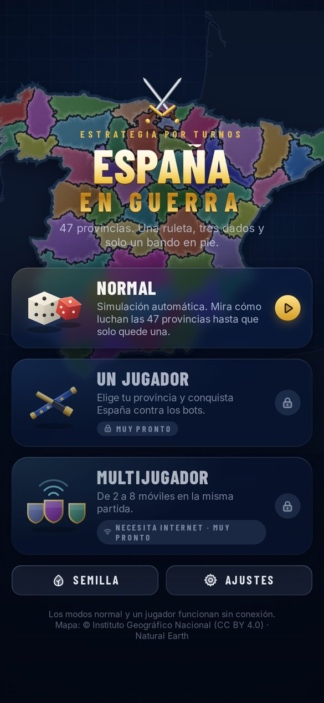
  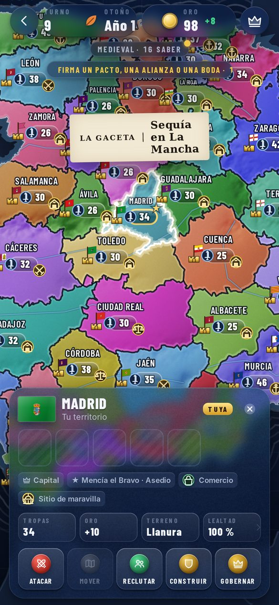
  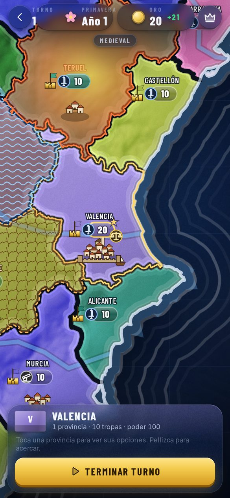
  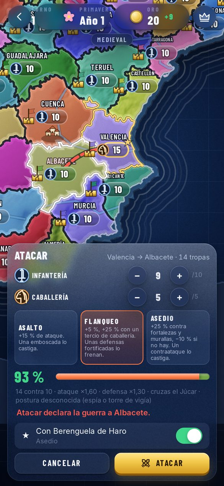
  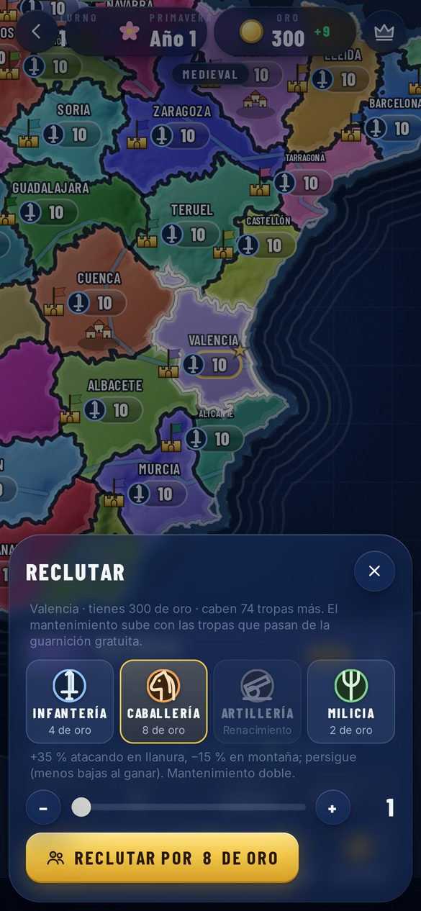
  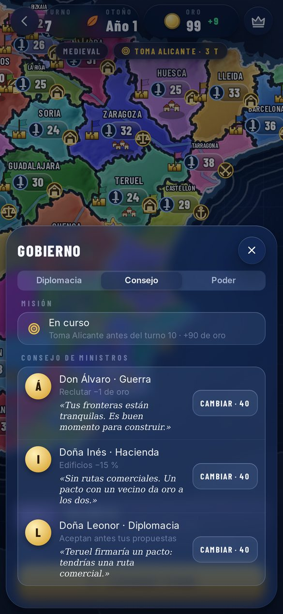
  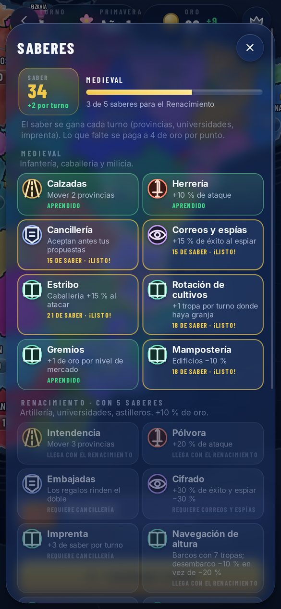
  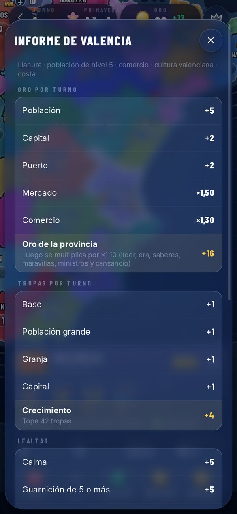
  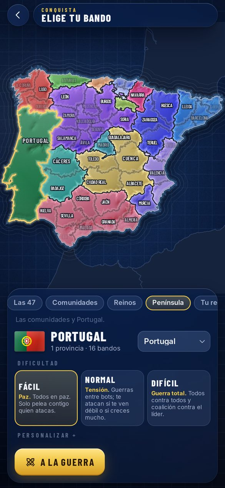
  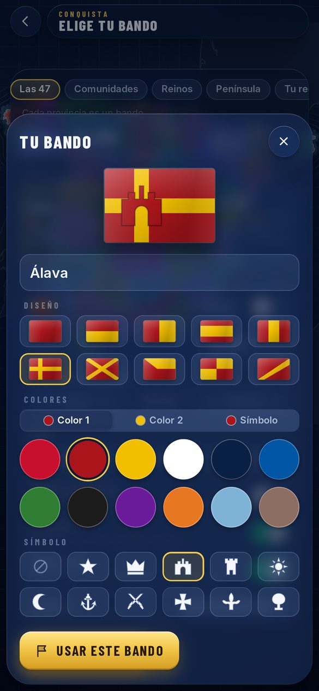
  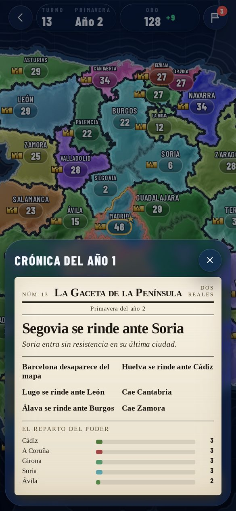
  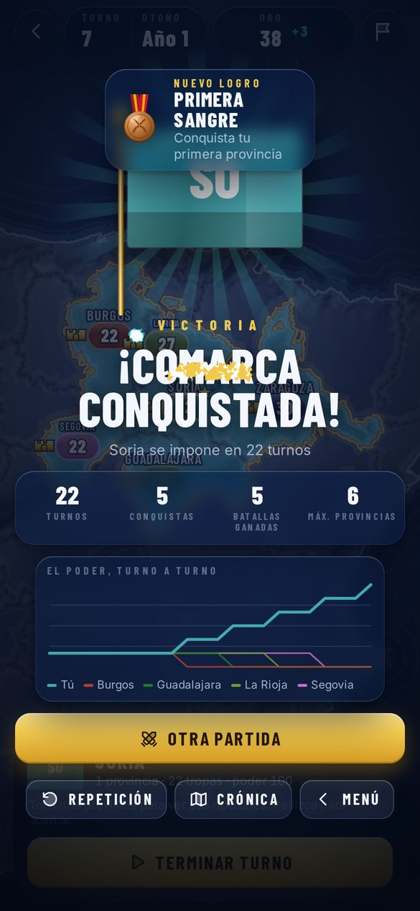
  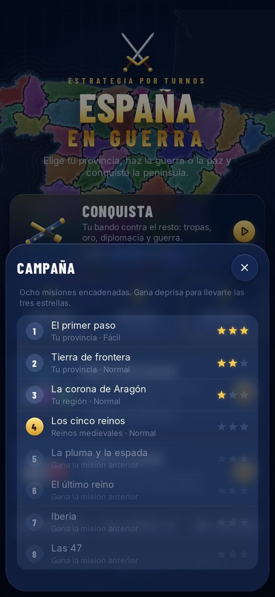
  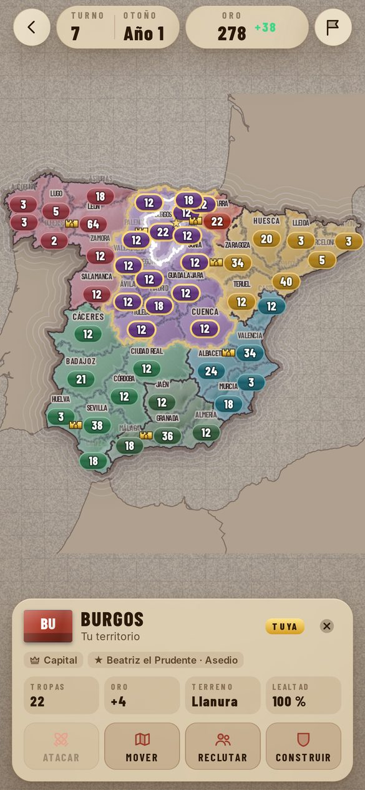
  
  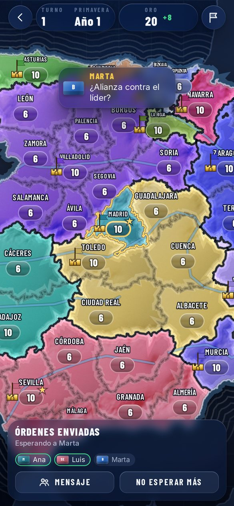
</p>

## Instalar en el iPhone

1. Abre **https://zyro0-z.github.io/Spain-War/** en Safari.
2. Pulsa **Compartir › Añadir a pantalla de inicio**.

## Cómo se juega

**Conquista** (un jugador): eliges escenario (las 47 provincias, las comunidades autónomas, los reinos hacia 1200, la península con Portugal, tu región contra las vecinas o tu provincia contra sus vecinas), tu bando y la dificultad. En tu turno tocas una provincia para atacar, mover tropas, reclutar, construir, espiar o hablar con otro bando; al terminar el turno actúan los bots.

- Combate con dados: cada lado tira 3d6 y gana quien saque más con «suma × fuerza». La fuerza sale de las tropas y su tipo, el terreno, los edificios, la moral, los generales y la táctica, y la probabilidad exacta se ve antes de atacar.
- Ejército: infantería, caballería (fuerte en llanura), artillería (abre murallas, desde el Renacimiento) y milicia (barata, solo defiende). Antes de atacar eliges táctica (asalto, flanqueo o asedio) contra la postura del defensor (emboscada, fortificar o contraataque), que solo ves si la espías. Las murallas exigen un asedio de varios turnos. Flota con desembarcos y bloqueos.
- Economía: oro por población, especialidad de cada provincia (vino, hierro, olivo, pesca…), impuestos ajustables, rutas comerciales con tus vecinos en paz y mantenimiento del ejército (si no pagas, desertan). Edificios con niveles en 2–4 huecos por provincia (granja, mercado, cuartel, fortaleza, murallas, puerto, mina, catedral, torre de vigía, caminos, universidad, astillero, almacén, hospital) y 13 maravillas únicas (la Alhambra, la Sagrada Familia, el Acueducto…).
- Diplomacia: paz, pacto, alianza, federación, bodas, regalos, tributo, vasallaje, ultimátum, compra de provincias, embargo y anexión pacífica. Antes de proponer ves si aceptarán y por qué. Romper un acuerdo es traición: todos desconfían. El cansancio de guerra pesa en el oro y la lealtad.
- Dificultad: **Fácil**, todos en paz y solo pelea contigo quien atacas · **Normal**, los bots se hacen la guerra y te atacan si te ven débil o si creces mucho · **Difícil**, guerra total y coalición contra el líder.
- Profundidad: terreno (montañas y sierras defienden mejor, y cruzar uno de los grandes ríos da +10 % al que defiende), suministro desde tu capital, lealtad, cultura y asimilación de lo conquistado, rebeliones, árbol de 24 saberes (estribo, imprenta, tercios, banca, fortificación abaluartada…) que se ganan cada turno y te llevan de la era Medieval al Renacimiento y a la Moderna, informe de cada provincia con el desglose de oro, tropas, lealtad y defensa, generales con árbol de habilidades que envejecen y pueden morir, espionaje (espiar, sabotear, agitar, asesinar, robar saberes, sobornar), consejo de ministros que aconseja, decisiones con varias opciones, misiones con premio, eventos, catástrofes regionales y estaciones con nieve en invierno.
- Personalizar (plegado): bando propio con nombre, lema, color en el mapa y bandera hecha en el editor (diseño, colores y símbolo), rasgo del líder, tropas al empezar, oro, número de rivales (el resto empieza como tierras libres), niebla de guerra, eventos, estaciones y tipo de victoria (dominación, capitales, diplomática, puntos o sobrevivir).
- Campaña de 8 misiones encadenadas con hasta 3 estrellas según los turnos, desafío del día (la misma partida para todos, 30 turnos a puntos, con clasificación) y tutorial interactivo.
- En el mapa: ríos, olas en la costa, nubes, ciudades que crecen con sus edificios (murallas, catedral, puerto, maravilla), catástrofes sobre las provincias, banderas ondeando sobre las capitales, fichas con el tipo de tropa que marchan al mover y atacar, y choque de espadas con las bajas en cada batalla. Panel de poder con la clasificación de todos los bandos.
- Titular de periódico en cada turno y crónica completa al empezar cada año, final con repetición del mapa turno a turno y gráfica del poder, 20 logros con medallas y música sintetizada que se vuelve tensa en guerra.
- Las partidas se guardan solas (hasta 5) y puedes deshacer movimientos, reclutas y edificios hasta tu último ataque.

Reglas completas y números en [docs/DISENO.md](docs/DISENO.md).

**Espectador**: las 47 provincias luchan solas con ruleta y dados (el modo original). La semilla repite la partida exacta (`?semilla=CÓDIGO`).

**Multijugador** (2 a 8 móviles, necesita internet): conquista con turnos simultáneos. Sala con código, enlace y QR; el anfitrión elige escenario, dificultad de los bots, reglas y tiempo por turno, y cada uno su bando (también su bando propio). Todos dan las órdenes a la vez; cuando terminan todos (o se acaba el tiempo) el turno se resuelve igual en cada móvil. Diplomacia entre jugadores, mensajes rápidos, espectadores y vuelta a la sala si se cierra Safari.

## Accesibilidad y ajustes

Temas Marina, Atlas, Pergamino, Táctico (nocturno) y Minimal, contraste alto, menos animaciones (cortes directos, sin partículas ni temblores), tamaño de texto según el iPhone o a mano, anuncios de cada ronda para VoiceOver, sonido sintetizado con interruptor y medidor de fotogramas.

## Desarrollo

Sin dependencias en tiempo de ejecución ni compilación: HTML, CSS y módulos de JavaScript con JSDoc y `// @ts-check`.

```
npm start            # servidor local en http://localhost:8080
npm test             # pruebas con node --test
npm run build:map    # regenera data/map.json (necesita npm install)
npm run flags        # descarga las banderas de Wikimedia Commons (o Actions › Banderas › Run workflow)
node scripts/shots.mjs webkit shots   # capturas en tamaño iPhone 14 con WebKit (WebKitWebDriver + Xvfb)
node scripts/shots.mjs chromium shots # lo mismo con Playwright y Chromium
node scripts/icons.mjs                # iconos de la app
```

| Ruta | Contenido |
| --- | --- |
| `js/conquest/` | Motor de la conquista (puro y determinista): reglas, fin de turno e IA, escenarios, campaña, logros y partida nueva |
| `js/engine/` | Generador con semilla, probabilidad exacta y la ruleta del modo espectador |
| `js/net/` | Transporte ntfy (y local para pruebas), sala de la conquista con turnos simultáneos y clasificación del desafío |
| `js/qr.js` | Código QR propio, sin librerías |
| `js/flags.js` | Banderas de las provincias |
| `js/map/render.js` | Mapa en canvas: imagen en memoria, cámara, temas, relieve, ríos, olas, onda de conquista y nombres |
| `js/ui/` | Menú, conquista, sala multijugador, preparación, editor de bandera, crónica, medallas, tutorial, espectador, dados 3D, ajustes y reloj |
| `js/music.js` · `js/flagmaker.js` | Música sintetizada y banderas dibujadas |
| `js/art.js` | Paleta de bandos e ilustraciones |
| `js/icons.js` | Iconos propios en dos tonos |
| `js/fx.js` | Sonido (WebAudio), partículas y temblor |
| `js/store.js` | Estado guardado y migraciones |
| `data/map.json` | Provincias, adyacencia, fronteras compartidas, costa, tierra vecina, ríos y Portugal |
| `scripts/` | Generación del mapa, capturas e iconos |
| `sw.js` | Modo sin conexión |

Al publicar cambios, sube la versión de `CACHE` en `sw.js` para que los móviles descarguen la nueva.

Créditos y licencias en [CREDITS.md](CREDITS.md).

## Probar el multijugador sin internet

Abre dos pestañas del mismo navegador con `?red=local` (la sala va por BroadcastChannel en vez de ntfy.sh). Las pruebas del protocolo (`tests/warroom.test.mjs`) usan un ntfy simulado: varios móviles llegan al mismo estado turno a turno, órdenes que chocan, tiempo agotado, abandono, reconexión, chat, órdenes troceadas y reintentos ante 429.
